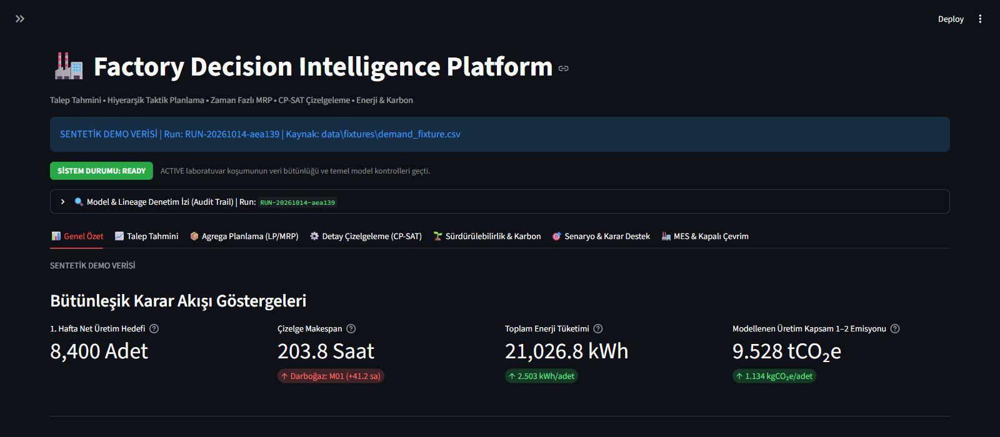
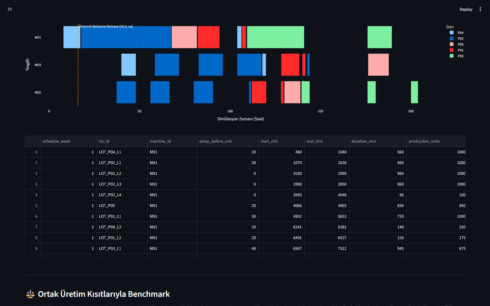
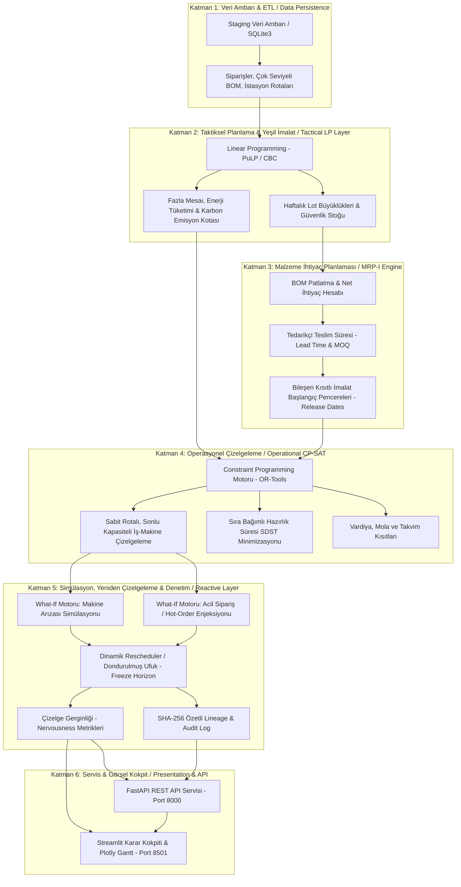

# 🏭 Factory Decision Intelligence System
### Decision Support POC, Hierarchical Optimization (LP & CP-SAT), Green Manufacturing & Dynamic Rescheduling Platform
### Endüstriyel Karar Destek, Hiyerarşik Optimizasyon (LP & CP-SAT), Yeşil İmalat ve Dinamik Yeniden Çizelgeleme Platformu

[](https://www.python.org/)
[](https://fastapi.tiangolo.com)
[](https://streamlit.io)
[](https://developers.google.com/optimization)
[](https://coin-or.github.io/pulp/)
[](https://github.com/AliUmutKazak/factory-decision-intelligence/actions/workflows/ci.yml)
[](https://beta.ruff.rs/docs/)
[](https://www.docker.com/)
[](https://opensource.org/licenses/MIT)

---

## Project overview / Proje özeti

Factory Decision Intelligence (FDI), üretim planı ve makine çizelgelemesi için **tek sunuculu bir karar destek laboratuvarı prototipidir**. Gösterilen sonuçlar sentetik veya açık benchmark verisidir; henüz fabrika, müşteri verisi, ERP/MES bağlantısı ya da saha faydası doğrulaması yoktur.



*14 Ekim sentetik demo ekranı; gerçek fabrika verisi veya sonraki kod sürümünün performans ölçümü değildir.*

<details>
<summary>14 Ekim CP-SAT çizelgesi ve operasyon ekranı</summary>



*Koşum: `RUN-20261014-aea139`. CP-SAT sonucu `FEASIBLE`; optimumluk kanıtı değildir.*
</details>

[Kurulum ve demo](docs/quickstart-lab.md) · [Sentetik dosya pilotu](examples/pilot-solve/README.md) · [Teknik kapsam ve kabul sınırı](docs/prefactory-technical-closure.md)

[Uluslararası ürün ve bilimsel yöntem denetimi](docs/global-evidence-audit-2026-10-15.md), tahmin modeli seçimi ile ayrı test penceresini ve kapsam sınırlarını kaydeder.

---

## Yol haritası ve kanıt durumu

**Son doğrulanmış laboratuvar etiketi:** [`v0.1.11-lab`](https://github.com/AliUmutKazak/factory-decision-intelligence/tree/v0.1.11-lab), commit `5057da9061380fc120a2979694504515af982a13`. [Aynı commit'in CI koşumu](https://github.com/AliUmutKazak/factory-decision-intelligence/actions/runs/39798272025) 418 test, danışma taraması ve temiz Docker başlangıç/yeniden başlatma işlerinde başarılıdır. [Temiz Windows klon provası](docs/clean-demo-v011-2026-10-22.md) ayrıca tamamlandı. CI'da 30 gün tutulan sentetik run paketinin digest'i, veri türü ve açık saha kapıları [kanıt envanterinde](docs/evidence-register.json) kayıtlıdır. Daha yeni bir kaynak commit'i bu etiketin test sonucunu otomatik devralmaz. [Bağımlılık güvenliği kaydı](docs/dependency-security-2026-10-11.md) bilinen danışma taramasının kapsamını ve kalan upstream sınırı açıklar; bu sonuç tesis güvenlik kabulü değildir.

**17 Ekim tarihsel plan–çizelge denetimi:** `77a5f13809730513a81557183454b1a5afd7d757` için [ana dal CI koşumu](https://github.com/AliUmutKazak/factory-decision-intelligence/actions/runs/39037061869) başarılıdır. [Aynı commit'in sentetik referans denetimi](docs/plan-schedule-gap-audit-2026-10-17.md), ilk hafta hedeflenen 8.400 adedin 6.100'ünün hafta bitiminde tamamlandığını ve 2.300'ünün sonraya sarktığını gösterir. Aynı modelde tüm 8.400 adede ilk hafta sonu sert bitiş koşulu eklendiğinde sonuç `INFEASIBLE` oldu; bu tarihsel ölçüm gerçek tesis kapasitesi veya güncel sürüm sonucu değildir.

**Hızlı inceleme:** [Temiz kurulum ve yerel demo](docs/quickstart-lab.md) · [dar sentetik dosya pilotu](examples/pilot-solve/README.md) · [sunulabilir iddialar](docs/factory-presentation-evidence-pack.md). Harici veri veya canlı ERP/MES erişimi gerektirmez.

Projenin PDF ile kararlaştırılan G0-G13 ilerlemesi ve açık kapıları [uygulama kaydında](docs/fdi-roadmap-execution.md) tutulur. [Açık benchmark ve veri sınırları](docs/benchmark-data-boundary-review.md), [sabit makineli dış çizelgeleme deneyi](docs/external-jsp-benchmark.md), [açık ambalaj verisi profili](docs/open-packaging-data-profile.md) ve [run paketi geri yükleme provası](docs/bundle-restore-rehearsal.md) teknik kanıtlardır. [Sentetik veri ve karar kapsamı](docs/synthetic-data-and-decision-scope.md), [G7 sentetik vaka matrisi](docs/g7-hot-order-stress-matrix.md), [eşlenik tek olay yöntemi kıyası](docs/g7-paired-hot-order-methods-2026-10-17.md), [genişletilmiş aday incelemesi ve kıyas](docs/decision-review-and-expanded-benchmark-2026-10-23.md), [ardışık iki olay ve freeze provası](docs/g7-two-event-freeze-rehearsal-2026-10-18.md), [düzeltilmiş eşlenik çoklu olay kıyası](docs/g7-calendar-overlap-correction-2026-10-18.md), [bağımsız takvim denetimi](docs/g7-calendar-candidate-audit.md) ve [malzeme zaman denetimi](docs/g7-material-release-audit.md) fabrika öncesi doğrulamanın kapsamını açıklar. Laboratuvar sonuçları pilot fabrika onayı veya gerçekleşmiş müşteri faydası olarak değerlendirilmez.

[Küresel kaynaklarla 11 Ekim teknik boşluk denetimi](docs/global-source-gap-review-2026-10-11.md), güvenlik, standart, çözücü ve veri platformu kararlarını birincil kaynaklara bağlar.

[Türkiye ve dünya bilim/pazar denetimi](docs/tr-global-science-market-audit-2026-10-11.md), akademik yöntemleri ve benzer APS ürünlerini FDI'nin gerçek kapsamıyla karşılaştırır. [Fabrika sunumu kanıt paketi](docs/factory-presentation-evidence-pack.md), gösterilebilir iddiaları, demo sırasını ve ilk görüşmede netleştirilecek kararları toplar.

[17 Ekim 2026 küresel/Türkiye ürün ve bilim boşluk denetimi](docs/global-turkey-product-science-audit-2026-10-17.md), Siemens, SAP, Asprova, Logo Netsis ve Türkiye'de sunulan APS örneklerini; ISA-95/IEC 62264, ISO 22400, OT güvenliği ve üretim çizelgeleme araştırmalarıyla karşılaştırır. Ürün beyanlarını bağımsız performans kanıtı olarak kullanmaz ve hangi açıkların saha erişimine bağlı olduğunu belirtir.

[14 Ekim stratejik rapor kararı](docs/validated-strategy-2026-10-14.md), kaynaklandırılmamış SaaS, AI ve tasarruf vaatlerini ayıklayıp mevcut POC kapsamını korur. [Problem keşfi rehberi](docs/problem-discovery-guide.md) ve [dar pilot ölçüm protokolü](docs/pilot-measurement-protocol.md) görüşme ve saha karşılaştırması için hazırlanmış şablonlardır; henüz müşteri bulgusu veya saha kabulü değildir.

[Metodolojik savunma raporu değerlendirmesi](docs/methodological-defense-review-2026-10-14.md), edge/B2MML, çözücü boşluğu ve TDABC iddialarının mevcut kanıt sınırını kaydeder; gölge gözlemi gerçekleşmiş etki deneyinden ayırır.

[Nihai gelişim raporunun güncel kanıtla değerlendirmesi](docs/final-development-decision-review-2026-10-14.md), rapordaki tarihsel sürüm bilgisini düzeltir ve global yöntem/ürün kaynaklarıyla doğrulanan küçük iyileştirmeyi kaydeder. Yerel dinamik yeniden çizelgeleme çağrısı doğrulanan adayı doğrudan ACTIVE yapar; bu akışta ayrı aday onayı veya saha planlamacısı kabulü henüz yoktur. What-if ekranındaki laboratuvar ön değerlendirmesi bu yayımlama akışından ayrıdır.

[17 Ekim bilimsel raporunun bağımsız denetimi](docs/scientific-review-2026-10-17.md), çözücü/benchmark deneyini, tahmin–MRP stok ayrımını ve LP hedefi–çizelgelenen bitiş farkını kaynakları ve sınırlarıyla kaydeder.

[Fabrika öncesi teknik kapsam ve teslim ölçüsü](docs/prefactory-technical-closure.md), bu sürümde yapılanları ve saha katılımı gerektiren kabul sınırını toplar.

**Paylaşım durumu:** Bu depo tek sunuculu bir karar destek POC'sidir. Referans/demo verisi sentetik veya açık benchmark kaynaklıdır; gerçek pilot fabrika, müşteri verisi ve ERP/MES test erişimi henüz yoktur. API ve panel varsayılan olarak kapalıdır; [yerel erişim anahtarları](docs/security-boundary.md#yerel-kullanım) yalnız laboratuvar demosu içindir. Servisi internete açmayın; Docker Compose yalnız yerel adrese bağlanır. [Sürüm kanıtı ve saha kabul sınırı](docs/release-evidence-and-field-boundary.md), teknik gösterim ile daha sonra gerekecek saha kabulünü ayırır.

### İnceleyenler için dört doğrulanabilir sonuç

| Sonuç | Kanıt | Geçerlilik sınırı |
|---|---|---|
| Uçtan uca planlama ve mühürlü ACTIVE sürümü | `python main.py` ardından `python scripts/verify_active_run.py`; [referans manifesti](artifacts/reference/manifest.json) | Referans veri sentetiktir; müşteri planı değildir |
| Dış çizelgeleme örneğinde optimum ve bağımsız fiziksel denetim | [OR-Library `ft06`: 55 birim, `OPTIMAL`](docs/external-jsp-benchmark.md) | Yalnız sabit makineli, düz statik JSP alt problemi |
| Aynı fiziksel girdide politika karşılaştırması ve maliyet bileşenleri | [Ölçülmüş model demosu](artifacts/demo/business-case.md) ve [yeniden üretme adımları](docs/demo-and-customer-pilot.md) | Hesaplanan karşılaştırma; gerçekleşmiş tasarruf veya finansal ROI değil |
| Dosya pilotu mevcut planı ile solver adayının dar kapsamlı kıyası | [Sentetik tek vardiyalı örnek](examples/pilot-solve/README.md) ve `python -m src.integration.pilot_file_solve examples/pilot-solve/manifest.json` | Bellekte, tam sipariş/boş WIP/fixed routing; müşteri veya üretim kabulü değil |

---

## 🌐 Executive Summary / Yönetici Özeti

### [TR] Sistem Özeti
**Factory Decision Intelligence System**, ayrık imalat (discrete manufacturing) tesisleri için operasyonel araştırmalar (Operations Research), malzeme gereksinim planlaması (MRP-I), yeşil imalat (green manufacturing) ve olay tabanlı dinamik çizelgelemeyi bir araya getiren karar destek prototipidir. Taktiksel düzeydeki çok dönemli kapasite ve emisyon kararlarını, operasyonel düzeyde sıra bağımlı hazırlık sürelerine (SDST) sahip sonlu kapasiteli tezgah çizelgelerine bağlar. Atölye zeminindeki beklenmeyen aksaklıklarda (makine arızaları, acil siparişler) dondurulmuş ufuk (freeze horizon) ve çizelge gerginliği (schedule nervousness) metrikleriyle kontrollü yeniden çizelgeleme yürütür.

### [EN] System Overview
The **Factory Decision Intelligence System** is a decision-support prototype uniting Operations Research (OR), multi-level Material Requirements Planning (MRP-I), green manufacturing constraints, and event-driven shop-floor rescheduling for discrete manufacturing plants. It bridges aggregate tactical decisions (capacity, energy costs, carbon emission caps) with operational finite-capacity machine scheduling featuring Sequence-Dependent Setup Times (SDST). For modeled events such as breakdowns and hot orders, it executes controlled rescheduling governed by a freeze horizon and quantitative schedule nervousness metrics.

---

## 📑 İçindekiler / Table of Contents
1. [Sistem Mimarisi ve Karar Akışı / System Architecture](#-sistem-mimarisi-ve-karar-akışı--system-architecture)
2. [Matematiksel Modelleme / Mathematical Formulations](#-matematiksel-modelleme--mathematical-formulations)
   - [Taktiksel Katman: LP, Enerji ve Karbon Kısıtları / Tactical LP & Green Constraints](#1-taktiksel-katman-çok-dönemli-agrega-ve-yeşil-planlama-lp)
   - [Operasyonel Katman: OR-Tools CP-SAT & SDST / Operational CP-SAT Model](#2-operasyonel-katman-kısıt-programlama-ile-çizelgeleme-cp-sat)
3. [Malzeme Gereksinim Planlaması / Material Requirements Planning (MRP-I)](#-malzeme-gereksinim-planlaması-mrp-i)
4. [Dinamik Müdahale & Karar Politikaları / Dynamic Policies & Rescheduling](#-dinamik-müdahale-karar-politikaları-ve-gerginlik-nervousness)
5. [Standart Operasyon Prosedürleri / Standard Operating Procedures (SOPs)](#-standart-operasyon-prosedürleri-sops)
6. [Kriptografik İzlenebilirlik / Lineage & Audit Trail](#-kriptografik-izlenebilirlik-lineage--audit-trail)
7. [Teknoloji Yığını / Technology Stack](#-teknoloji-yığını--technology-stack)
8. [API Servis Katmanı & Sözleşmeler / API Layer & Contracts](#-api-servis-katmanı-ve-uç-noktalar)
9. [Karar Destek Kokpiti / Interactive Cockpit (Streamlit)](#-karar-destek-kokpiti-streamlit)
10. [Kurulum, Test & Çalıştırma / Installation & Verification](#-kurulum-test-ve-çalıştırma-rehberi)
11. [Docker ile Konteyner Dağıtımı / Docker Deployment](#-docker-ile-dağıtım)
12. [Dizin Yapısı / Directory Tree](#-dizin-yapısı--directory-tree)

---

## 🏗️ Sistem Mimarisi ve Karar Akışı / System Architecture

Sistem, endüstriyel karar piramidini hiyerarşik katmanlar halinde modeller:



---

## 📐 Matematiksel Modelleme / Mathematical Formulations

### 1. Taktiksel Katman: Çok Dönemli Agrega ve Yeşil Planlama (LP)
Model; müşteri taleplerini karşılarken üretim maliyeti, stok tutma maliyeti, fazla mesai maliyeti, gecikme (backlog) cezaları ile birlikte **enerji tüketim giderleri** ve **karbon salımı vergisi/kotalarını** bütüncül olarak minimize eder.

#### İndeksler ve Kümeler (Sets & Indices)
* $p \in P$: Nihai ürün aileleri ($p = 1, \dots, \vert{}P\vert{}$)
* $t \in T$: Planlama dönemleri (Haftalar: $t = 1, \dots, N$)
* $m \in M$: Makine / İstasyon grupları ($m = 1, \dots, \vert{}M\vert{}$)

#### Parametreler (Parameters)
* $D_{p,t}$: $t$ döneminde $p$ ürünü için müşteri talebi (adet)
* $CAP_{m,t}^{reg}$: $m$ istasyonunun $t$ dönemindeki normal çalışma kapasitesi (saat)
* $CAP_{m,t}^{ot\_max}$: $m$ istasyonunun azami fazla mesai limiti (saat)
* $a_{p,m}$: Ürün $p$'nin $m$ istasyonunda birim işlenme süresi (saat/adet)
* $c^p_{prod}$: Birim üretim maliyeti ($/adet)
* $h_p$: Dönem sonu birim stok tutma maliyeti ($/adet/dönem)
* $\pi_p$: Birim gecikmiş talep (backlog) cezası ($/adet)
* $c^m_{ot}$: İstasyon bazlı saatlik fazla mesai ücreti ($/saat)
* $e_p$: Ürün $p$'nin birim üretiminde harcanan enerji (kWh/adet)
* $c_{energy}$: Birim elektrik enerjisi fiyatı ($/kWh)
* $co2_p$: Ürün $p$'nin üretimi kaynaklı karbon salımı ($kg\ CO_2/adet$)
* $c_{carbon}$: Model içi karbon fiyatı varsayımı ($/kg\ CO_2$); uygulanmış vergi veya gerçekleşmiş maliyet değildir
* $CO2_{cap,t}$: $t$ dönemi için modelde varsayılan karbon senaryosu üst sınırı ($kg$); mevzuat limiti değildir

#### Karar Değişkenleri (Decision Variables)
* $X_{p,t} \ge 0$: $t$ döneminde üretilecek $p$ ürün hacmi
* $I_{p,t} \ge 0$: $t$ dönemi sonundaki $p$ ürün envanter düzeyi
* $S_{p,t} \ge 0$: $t$ döneminde karşılanamayan gecikmiş talep miktarı (backlog)
* $O_{m,t} \ge 0$: $t$ döneminde $m$ makinesinde uygulanan fazla mesai saati

#### Amaç Fonksiyonu (Objective Function)
$$\min Z = \sum_{t \in T} \Bigg[ \sum_{p \in P} \Big( c^p_{prod} X_{p,t} + h_p I_{p,t} + \pi_p S_{p,t} + \big(e_p \cdot c_{energy} + co2_p \cdot c_{carbon}\big) X_{p,t} \Big) + \sum_{m \in M} c^m_{ot} O_{m,t} \Bigg]$$

#### Kısıtlar (Constraints)
1. **Malzeme Dengesi ve Akış Kısıtı (Inventory Flow Balance):**
   $$I_{p,t-1} + X_{p,t} + S_{p,t} - S_{p,t-1} - I_{p,t} = D_{p,t} \quad \forall p \in P, \forall t \in T$$
2. **Kapasite ve Fazla Mesai Sınırı (Capacity & Overtime Upper Bound):**
   $$\sum_{p \in P} a_{p,m} X_{p,t} \le CAP_{m,t}^{reg} + O_{m,t} \quad \forall m \in M, \forall t \in T$$
   $$O_{m,t} \le CAP_{m,t}^{ot\_max} \quad \forall m \in M, \forall t \in T$$
3. **Yeşil İmalat: Dönemsel Karbon Kotası (Carbon Emission Ceiling):**
   $$\sum_{p \in P} co2_p X_{p,t} \le CO2_{cap,t} \quad \forall t \in T$$
4. **Başlangıç Durumları (Boundary Conditions):**
   $$I_{p,0} = Stok_{p}^{baslangic}, \quad S_{p,0} = 0 \quad \forall p \in P$$

---

### 2. Operasyonel Katman: Kısıt Programlama ile Çizelgeleme (CP-SAT)
Google OR-Tools CP-SAT motoru ile sonlu kapasiteli, sıra bağımlı hazırlık süreli (SDST) operasyonel çizelge oluşturulur.

#### Değişkenler ve Aralıklar (Interval Variables)
Her bir üretim görevi $i \in J$ için çözücü üzerinde aralık değişkeni tanımlanır:
$$Interval_i = [S_i, E_i, D_i] \implies E_i = S_i + D_i$$
* $S_i \in [0, T_{max}]$: Operasyon başlangıç dakikası
* $E_i \in [0, T_{max}]$: Operasyon bitiş dakikası
* $D_i$: İşlem süresi (Processing Duration)

#### Kısıtlar ve Mantıksal Kurallar
1. **Kaynak Çakışmama Kısıtı (Disjunctive Resource / No-Overlap):**
   Aynı tezgaha atanan herhangi iki operasyon $i$ ve $j$ zaman ekseninde örtüşemez:
   $$\text{NoOverlap}\big(\{Interval_i \mid Makine(i) = m\}\big) \implies (E_i \le S_j) \lor (E_j \le S_i)$$
2. **Sıra Bağımlı Hazırlık Süreleri (Sequence-Dependent Setup Times - SDST):**
   $i$ ürün grubundan $j$ ürün grubuna geçişte tezgahta temizlik, kalıp değişimi veya ayar süresi ($\tau_{type(i), type(j)}$) zorunludur:
   $$S_j \ge E_i + \tau_{type(i), type(j)} \quad (\text{eğer } j \text{ operasyonu } i\text{'nin hemen ardılı ise})$$
3. **Teknolojik Öncelik İlişkileri (Routing Precedence Constraints):**
   Aynı işin operasyonları proses sırasına uymak zorundadır:
   $$S_{job, op+1} \ge E_{job, op}$$
4. **Malzeme ve Tedarikçi Hazır Olma Kısıtı (Material Release Date):**
   MRP patlatmasından gelen hammadde ve bileşenler depoya girmeden imalat başlatılamaz:
   $$S_i \ge ReleaseTime_i$$
5. **Amaç Fonksiyonu:**
   Tamamlanma süresini (Makespan - $C_{max}$) ve termin gecikmelerini minimize etme:
   $$\min \left( \alpha \cdot C_{max} + \beta \sum_{i \in J} \max(0, E_i - DueDate_i) \right)$$

---

## 📦 Malzeme Gereksinim Planlaması (MRP-I)

Taktiksel LP planının ürettiği haftalık lot büyüklükleri, operasyonel seviyeye malzeme kısıtları olarak aktarılır:
* **Çok Seviyeli BOM Patlatma (Explosion):** Üst montajdan hammaddeye kadar hiyerarşik çarpan hesabı.
* **Tedarikçi Teslim Süresi Dengesi (Lead-Time Offsetting):** Parça temin süresi ($LT_k$) ve Minimum Sipariş Miktarı ($MOQ_k$) gözetilerek satın alma sipariş tarihleri geriye doğru çizelgelenir.
* **Malzeme Kısıtlı Çizelgeleme (Material-Constrained Scheduling):** Her operasyon için $ReleaseTime_i$ değeri malzeme varış saatine kilitlenerek sahada parça bekleme israfı önlenir.

---

## ⚡ Dinamik Müdahale, Karar Politikaları ve Gerginlik (Nervousness)

Atölye zemininde belirsizlikler gerçekleştiğinde uygulanan dinamik politikalar:

### 1. Dondurulmuş Ufuk Politikası (Freeze Horizon Policy)
Mevcut zamandan ($t_{now}$) itibaren belirlenen dondurma periyodu ($H_{freeze}$) içindeki operasyonlar sahada hazırlığı tamamlanmış veya işlem görmekte kabul edilir:
$$S_i = S_i^{orijinal}, \quad Makine_i = Makine_i^{orijinal} \quad \forall i \text{ where } S_i < t_{now} + H_{freeze} \text{ or } S_i \le t_{now}$$
Bu operasyonların sırası ve makine atamaları yeniden çizelgelemede **değiştirilemez**.
MES'te başlamış veya tamamlanmış operasyonlar, planlanan başlangıçları ileride olsa bile dondurulur. Dondurulmuş ufuktan sonraki `flexible_horizon_min` içindeki görevler FLEXIBLE durumundadır; aynı makinede kalır ve başlangıçları önceki değerden en fazla `max_flexible_shift_min` kadar hareket edebilir. Bu sınırları aşan sonuç kabul edilmez. Yayın öncesi bağımsız [aday denetimi](docs/reschedule-core-candidate-audit-2026-10-17.md) temel zaman, setup aralığı, makine çakışması ve rota öncüllüğünü de kontrol eder; kapsam sınırları bağlantıdaki notta belirtilir.

Duruş, etkilenen tezgâhtaki dondurulmuş görevlerden sonra uygulanır; başlamış operasyonu kesip devam ettirme modellenmez. Ayrıntılar: [Run isolation and rescheduling](docs/run-isolation-and-rescheduling.md).

`OPERATIONAL_BALANCED` süreleri dengeler. `COST_OPTIMIZED` parasal olarak ifade edilen TMC hedefidir: işçilik, setup, OT primleri, WIP holding, ağırlıklı gecikme, enerji, karbon, malzeme ve W1 expedite maliyetlerini `EconomicConfig` oranlarıyla minimize eder. Bu oranlar fabrika finansınca doğrulanmış tutarlar değildir. Sonuç ve bound para birimindedir; mikro para birimi yuvarlaması kaydedilir. FEASIBLE sonuç optimum veya diğer politikadan daha düşük maliyet garantisi değildir.

Orkestratör önce mevcut makine sırasını koruyan yerel onarım adayı üretir ve ortak üretim CP-SAT modeliyle bütün zamanları doğrular. Kabul edilirse `VALIDATED_LOCAL_REPAIR`, reddedilirse gerekçesiyle `CPSAT_REOPTIMIZATION` audit’e kaydedilir. Yerel doğrulama küresel optimum olarak işaretlenmez. Gerçek freeze/FLEXIBLE/duruş kısıtları yeni sürümde yeniden oynatılabilir biçimde saklanır.

### 2. Çizelge Gerginliği Metrikleri (Schedule Nervousness Metrics)
Yeniden optimizasyonun sahada yaratacağı operasyonel kaosu sınırlamak için iki metrik ölçülür:
* **Başlangıç Zamanı Sapması (Start Time Displacement):**
  $$\Delta S = \frac{1}{\vert{}J'\vert{}} \sum_{i \in J'} \vert{}S_i^{yeni} - S_i^{eski}\vert{}$$
* **Sıra Değişimi Adedi (Sequence Inversion Count):**
  Tezgahlardaki iş sıralamasının yer değiştirme sayısı.

---

## 📋 Standart Operasyon Prosedürleri (SOPs)

### SOP-01: Rutin Haftalık Planlama Çevrimi (Weekly Planning Routine)
1. **Veri Çekme:** Staging veritabanından güncel talep tahminleri ve envanter seviyeleri yüklenir.
2. **LP Çalıştırma:** PuLP modeli koşturularak haftalık agrega üretim hacimleri, fazla mesailer ve karbon bütçesi hesaplanır.
3. **MRP Patlatma:** Reçeteler (BOM) taranarak malzeme teslim tarihleri ve serbest bırakma saatleri ($ReleaseTime_i$) oluşturulur.
4. **CP-SAT Çizelgeleme:** OR-Tools motoru haftalık sonlu kapasiteli çizelgeyi üretir.
5. **Yayınlama:** Çizelge SQLite'a işlenir ve FastAPI/Streamlit üzerinden dağıtılır.

### SOP-02: Makine Arızası Müdahale Prosedürü (Breakdown Response)
1. **Varsayımsal analiz:** Makine, duruş başlangıcı ve süresiyle `/api/v1/schedule/what-if/breakdown` çağrılır. Bu çağrı zamanı sıfırdan başlayan ayrı bir plan üretir; yürütülmüş işi veya dondurulmuş ufku temsil etmez.
2. **Gerçek olay:** Saha olayı doğrulanırsa `/api/v1/schedule/reschedule` için olay zamanı ve dondurma ufku ayrıca verilir. Adayın fiziksel ve freeze kuralları bağımsız denetlenir. Laboratuvar API'si kabul edilen adayı doğrudan `ACTIVE` yayımlar; doğrulanmış planlamacı onayı ve saha actuals akışı henüz yoktur.

### SOP-03: Acil Sipariş Enjeksiyon Prosedürü (Hot-Order Injection)
1. **Öncelik Tanımlama:** Acil sipariş yüksek öncelik bayrağı ve teslim tarihi ile sisteme verilir.
2. **Plan etkisi:** `/api/v1/schedule/what-if/hot-order` ayrı bir aday çizelge ve planlanan KPI farklarını döndürür; mevcut müşteri teslimatının fiili sonucu veya otomatik kapasite tahsisi değildir.
3. **Operasyonel karar:** Mesai, öncelik ve yayımlama kararı saha kuralları ile yetkili planlamacıya aittir.

What-if fark raporunda makespan, hazırlık süresi ve lot başına öncelik ağırlıklı gecikme, çözücü özetinden bağımsız olarak baz ve aday çizelge satırlarından hesaplanır. Bunlar planlanan senaryo değerleridir; gerçekleşmiş teslimat veya tasarruf ölçüsü değildir.

---

## 🛡️ Kriptografik İzlenebilirlik (Lineage & Audit Trail)

Yayınlanan yeniden çizelgeleme kararları audit tablosuna ve karar kütüğüne kaydedilir; bundle dosyalarının SHA-256 özetleri değişiklikleri tespit eder. Sandbox what-if işlemleri runtime verisini değiştirmez:
* **Olay Kaydı:** Tetikleyici olay tipi (`BREAKDOWN`, `HOT_ORDER`, `PERIODIC`).
* **Veri Özeti (Cryptographic Hash):** Girdi ve çıktı çizelgeleri **SHA-256** özeti alınarak değişiklik denetimine bağlanır. Bu özet dijital imza veya yazma yetkisi ele geçirilmiş bir ortama karşı sahicilik kanıtı değildir.
* **Denetim Tablosu:** SQLite `reschedule_audit_log` tablosunda saklanır ve `/api/v1/schedule/audit-log` üzerinden denetlenebilir.

---

## 🧰 Teknoloji Yığını / Technology Stack

| Alan / Layer | Teknoloji / Kütüphane | Versiyon / Standart | Açıklama |
|---|---|---|---|
| **Matematiksel Modelleme** | Google OR-Tools (CP-SAT), PuLP | Python Library | Ayrık kısıt programlama ve lineer programlama çözücüleri |
| **Backend & REST Servis** | FastAPI, Uvicorn | 0.110+ | Asenkron, OpenAPI/Swagger destekli servis mimarisi |
| **Veri Şeması & Doğrulama** | Pydantic | v2.x | Tip güvenliği ve veri sözleşmeleri (Contracts) |
| **Karar Kokpiti & UI** | Streamlit, Plotly Express | 1.32+ | İnteraktif Gantt şeması, senaryo kıyası ve yönetici kokpiti |
| **Veri Tabanı & Analitik** | SQLite3, Pandas, NumPy | Python Builtin / 2.x | Veri ambarı, staging hatları ve denetim logları |
| **Test & Kalite Güvencesi**| Pytest, Ruff, GitHub Actions | CI quality gates | Birim, regresyon, entegrasyon ve Docker başlangıç testleri |
| **Konteynerizasyon** | Docker, Docker Compose | Python 3.11-slim | Pipeline hazırlığı, ACTIVE doğrulaması ve servis başlangıcı |

---

## 🔌 API Servis Katmanı ve Uç Noktalar

FastAPI backend servisi `http://localhost:8000` portunda yayın yapar. İnteraktif Swagger arayüzüne `http://localhost:8000/docs` adresinden erişilebilir:

`/health` ve `/ready` dışındaki uçlar [yerel erişim anahtarı](docs/security-boundary.md#yerel-kullanım) gerektirir. Swagger'daki **Authorize** alanına ilgili Bearer anahtarını girin.

API, panel ve yerel MES dispatcher aynı runtime üzerinde aynı anda tek çözücü çalıştırır. Çakışan API çağrısı `429/SOLVER_BUSY` ve `Retry-After` döndürür; panel isteği meşgul uyarısı gösterir. Bu sınır tek hostlu laboratuvar kullanımına aittir.

| Metot | Uç Nokta (Endpoint) | Parametre / Gövde (Payload) | Açıklama |
|---|---|---|---|
| `GET` | `/health` | - | Servis canlılığı |
| `GET` | `/ready` | - | ACTIVE sürüm ve solver metadata kontrolü; run_id döndürür |
| `GET` | `/api/v1/operations/status` | `?max_active_age_min=1440` | Yetkili okuma anahtarıyla ACTIVE yayın yaşı, saat durumu ve bekleyen yerel MES niyetleri |
| `GET` | `/api/v1/schedule/current` | - | SQLite üzerindeki aktif operasyonel çizelgeyi döndürür |
| `POST` | `/api/v1/schedule/what-if/breakdown` | `{"machine_id": "M01", "start_min": 480, "duration_min": 60}` | Makine duruşunu simüle eder; gecikme ve sapma analizi sunar |
| `POST` | `/api/v1/schedule/what-if/hot-order` | `{"order_id": "HOT_01", "product_id": "P01", "quantity": 25, "due_date_min": 2880, "priority_weight": 10}` | Acil siparişin mevcut çizelge üzerindeki etkisini hesaplar |
| `POST` | `/api/v1/schedule/reschedule` | `{"trigger": {"event_id": "EVT-01", "current_time_min": 480, "freeze_horizon_min": 60, "delay_machine_id": "M01", "delay_duration_min": 60}}` | Dondurulmuş ufuk kurallarıyla yeni çizelgeyi üretir ve kaydeder |
| `GET` | `/api/v1/schedule/audit-log` | `?limit=50` | ACTIVE sürüme bağlı kalıcı yeniden çizelgeleme denetim kayıtlarını listeler |
| `GET` | `/api/v1/decisions` | - | ACTIVE sürümün SQLite'a kaydedilmiş karar gerekçelerini salt okunur olarak döndürür |

Karar geçmişi SQLite'ta kalıcıdır; yeniden çizelgeleme kararları sürüm kimliğiyle sorgulanır. Bu, tek sunuculu POC denetim kaydıdır; harici bir enterprise audit platformu iddiası taşımaz.

ISA-95 adaptörleri kanonik sözleşmeler ile MESA B2MML 0701 resmî XSD’lerine karşı doğrulanan çizelge/MES XML export ve import sağlar. Desteklenen fabrika profili, timezone-aware Pazartesi başlangıç zamanı ve kaynak şema hash’leri açıkça tanımlıdır. Belirli vendor endpoint’iyle gerçek birlikte çalışabilirlik müşteri kabul testi gerektirir; yapılmış olarak gösterilmez.

Dashboard benchmark’ı kullanıcı düğmesiyle başlatılır. FIFO/EDD/SPT/Greedy makine sırasını seçer; her çizelge aynı üretim CP-SAT modeli, veri snapshot’ı, takvim, bakım, rota, setup, malzeme, OT ve freeze/FLEXIBLE kısıtları altında yerleştirilir. Çizelge üzerindeki lot gecikmeleri, model maliyetleri, süreler ve ölçülen EDD farkı raporlanır. Saf sezgisel runtime karşılaştırması veya müşteri ROI kanıtı değildir. [Ölçülmüş demo](artifacts/demo/business-case.md) ve [demo/müşteri pilot rehberi](docs/demo-and-customer-pilot.md) yeniden üretme adımlarını içerir.

---

## 📊 Karar Destek Kokpiti (Streamlit)

Streamlit karar paneli (`http://localhost:8501`), karar vericilere interaktif yetenekler sunar:
* **Gantt Çizelgesi Görselleştirme:** Makine, ürün grubu ve SDST hazırlık sürelerinin zaman çizelgesindeki renkli dağılımı.
* **Darboğaz & Kapasite Paneli:** İstasyon doluluk oranları, bekleme süreleri ve fazla mesai analizleri.
* **What-If Simülatörü:** Web arayüzünden arıza veya acil sipariş tetikleyerek çizelgeleri yan yana karşılaştırma.
* **Lineage & Audit Gezgini:** Sistem kararlarının ve kriptografik özetlerin denetim dökümü.

---

## 🚀 Kurulum, Test ve Çalıştırma Rehberi

### 1. Yerel Python Ortamı Kurulumu

```text
git clone https://github.com/AliUmutKazak/factory-decision-intelligence.git
cd factory-decision-intelligence
```

Python 3.11 ile, kullandığınız kabuğa uygun komutları çalıştırın.

Windows PowerShell:

```powershell
python --version # 3.11.x olmalı
python -m venv factory-env
.\factory-env\Scripts\python.exe -m pip install -r requirements-windows.lock
```

Linux x86_64:

```bash
python3.11 -m venv factory-env
source factory-env/bin/activate
python -m pip install -r requirements-linux.lock # Linux x86_64
```

macOS veya farklı mimaride `requirements.txt` üzerinden kurulum yapılır; bu platformlarda transitive lock doğrulaması bu sürümün CI kapsamına dahil değildir.

Sonraki `python` komutlarında Windows'ta `.\factory-env\Scripts\python.exe` kullanın veya ortamı `.\factory-env\Scripts\Activate.ps1` ile etkinleştirin. PowerShell yürütme ilkesi etkinleştirmeyi engelliyorsa doğrudan `python.exe` yolu yeterlidir.

### 2. Pipeline, doğrulama ve testler

Servislerden ve entegrasyon testlerinden önce doğrulanmış bir ACTIVE plan oluşturun:

```bash
python main.py
python scripts/verify_active_run.py
python -m pytest tests/ -v
```

### 3. FastAPI Servisini Başlatma

```bash
uvicorn src.api.server:app --reload --port 8000
```
* **Swagger Arayüzü:** `http://localhost:8000/docs`
* **Health Check:** `http://localhost:8000/health`

### 4. Karar Destek Kokpitini Başlatma (Streamlit)

Ayrı bir terminalde:
```bash
streamlit run dashboard/app.py
```
* **Kullanıcı Paneli:** `http://localhost:8501`

---

## 🐳 Docker ile Dağıtım

Docker Compose ilk başlangıçta pipeline çalıştırır, bundle ve ACTIVE run doğrulamasından sonra API ve dashboard servislerini açar. Sonraki başlangıçlarda doğrulanmış mevcut ACTIVE sürümü kullanır:

Linux/macOS:

```bash
export FACTORY_BUILD_GIT_SHA="$(git rev-parse HEAD)"
docker compose up --build -d --wait --wait-timeout 240 api dashboard
```

Windows PowerShell:

```powershell
$env:FACTORY_BUILD_GIT_SHA = git rev-parse HEAD
$env:FDI_API_READ_TOKEN = python -c "import secrets; print(secrets.token_urlsafe(48))"
$env:FDI_API_SCENARIO_TOKEN = python -c "import secrets; print(secrets.token_urlsafe(48))"
$env:FDI_API_RESCHEDULE_TOKEN = python -c "import secrets; print(secrets.token_urlsafe(48))"
docker compose up --build -d --wait --wait-timeout 240 api dashboard
```

* **FastAPI Backend:** `http://localhost:8000/docs`
* **Streamlit Dashboard:** `http://localhost:8501`
* **Hazır olma kontrolü:** `http://localhost:8000/ready`
* **Durdurmak için:** `docker compose down`

Panelin kenar çubuğuna bu oturum için uygun anahtarı girin. Anahtarlar yalnız bu PowerShell oturumunun ortamında kalır; aynı oturumdan başlatılan Compose servislerine aktarılır.

`data/`, `reports/` ve `artifacts/runs/` kalıcı ve servisler arasında paylaşılan dizinlerdir. Mevcut ACTIVE bundle doğrulanamazsa başlangıç durur. Bilinçli yeni plan üretimi için `docker compose run --rm pipeline python scripts/bootstrap_runtime.py --refresh` çalıştırın. Temiz Docker başlangıcı ve yeniden başlatma CI içinde sınanır. Bu dağıtım tek sunuculu demo/POC içindir; üretim SaaS hazır olduğu iddia edilmez.

---

## 📂 Dizin Yapısı / Directory Tree

```text
factory-decision-intelligence/
├── data/                       # Üretim veritabanı (factory.db) ve staging tabloları
├── dashboard/                  # Streamlit karar destek arayüzü
│   └── app.py                  # Karar kokpiti, Gantt grafikleri ve senaryo paneli
├── src/
│   ├── api/                    # FastAPI REST servis mimarisi
│   │   └── server.py           # Endpoint tanımları ve HTTP işleyicileri
│   ├── contracts/              # Pydantic veri sözleşmeleri ve şemaları
│   ├── planning/               # Kademe 1: Taktiksel LP Planlama (PuLP / CBC)
│   ├── mrp/                    # Kademe 2: MRP-I, BOM patlatma ve lead-time dengeleme
│   ├── scheduling/             # Kademe 3 & 5: CP-SAT Çizelgeleme ve What-If motoru
│   │   ├── schedule_cpsat.py   # OR-Tools sonlu kapasite çizelgeleyicisi
│   │   ├── what_if.py          # Arıza ve acil sipariş simülatörü
│   │   └── rescheduler.py      # Freeze Horizon & Dinamik Rescheduler
│   └── config.py               # Konfigürasyon, yollar ve ortam değişkenleri
├── tests/                      # Birim, entegrasyon ve regresyon testleri
├── Dockerfile                  # Python 3.11-slim Docker imaj reçetesi
├── docker-compose.yml          # FastAPI ve Streamlit mikroservis orkestrasyonu
├── .dockerignore               # Docker imaj filtreleme kuralları
├── requirements.txt            # Doğrudan Python bağımlılıkları
├── requirements-linux.lock     # Linux x86_64 / Python 3.11 tam çözüm
├── requirements-windows.lock   # Windows x86_64 / Python 3.11 tam çözüm
└── README.md                   # Kapsamlı sistem ve mimari dokümantasyonu
```

---

## 📜 Lisans & Geliştirici / License & Author

* **Geliştirici / Author:** Ali Umut Kazak — Endüstri Mühendisi / Karar Zekası & Optimizasyon
* **Lisans / License:** Projenin özgün kodu ve belgeleri [MIT](LICENSE) lisanslıdır. `src/contracts/xsd/b2mml-0701/` altındaki MESA şemaları [kendi lisansı](src/contracts/xsd/b2mml-0701/LICENSE) kapsamındadır. The Business To Manufacturing Markup Language (B2MML) is used courtesy of MESA International.
