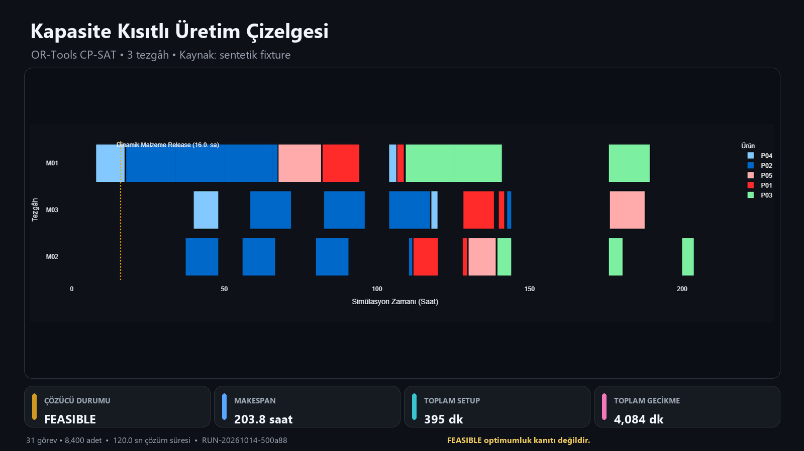

# Factory Decision Intelligence (FDI)

**A reproducible decision-support prototype for discrete manufacturing.**

[](https://github.com/AliUmutKazak/factory-decision-intelligence/actions/workflows/ci.yml)
[](https://www.python.org/)
[](LICENSE)

When a machine breaks down or a rush order arrives, planners must rebuild the schedule quickly without breaking material, calendar or setup constraints. FDI is built to make that decision traceable and checkable.

FDI connects demand forecasting, tactical capacity planning, material requirements and finite-capacity machine scheduling in one local workflow. It also evaluates machine-breakdown and rush-order scenarios against a baseline schedule, with operation-level changes and solver status visible to the reviewer.

> **Project status:** laboratory prototype tested with synthetic and public benchmark data. No factory pilot, customer data, live ERP/MES integration or measured production benefit is claimed.



*Capacity-constrained schedule from a synthetic demonstration run; the displayed figures are illustrative, not factory results.*

## What the system does

| Stage | Output |
|---|---|
| Demand | Rolling-origin forecast evaluation and product-level demand estimates |
| Tactical planning | Multi-period capacity, overtime and carbon-constrained LP decisions |
| Material planning | Time-phased MRP-I and material release times |
| Scheduling | OR-Tools CP-SAT schedules with fixed routes, finite capacity, calendars and sequence-dependent setup times |
| Decision review | Baseline-versus-candidate KPIs, changed operations, solver evidence and isolated what-if scenarios |
| Traceability | Versioned ACTIVE runs, independent schedule checks and auditable local outputs |

The decision chain is **forecast → LP plan → MRP-I → CP-SAT schedule → scenario review**. The [technical reference (TR)](docs/system-reference.md) describes the model, constraints, APIs and deployment in detail.

## Evidence and limits

- The [public OR-Library job-shop benchmark](docs/external-jsp-benchmark.md) checks scheduling feasibility independently. Additional `la03`–`la05` runs and paired rush-order experiments are documented with [raw results and failure counts](docs/decision-review-and-expanded-benchmark-2026-10-23.md).
- The [CI workflow](https://github.com/AliUmutKazak/factory-decision-intelligence/actions/workflows/ci.yml) runs the pipeline, tests, dependency checks and a clean Docker startup and restart.
- Solver feasibility, benchmark scores and modeled costs do **not** establish factory acceptance, realized savings or production readiness. The [scope and field-validation boundary](docs/prefactory-technical-closure.md) records what still needs a pilot site.

## Run the local laboratory workflow

Python **3.11** is required. From a fresh checkout, install the platform lock file, build a synthetic ACTIVE run and verify it:

```powershell
py -3.11 -m venv .venv
.\.venv\Scripts\python.exe -m pip install -r requirements-windows.lock
.\.venv\Scripts\python.exe main.py
.\.venv\Scripts\python.exe scripts/verify_active_run.py
```

For Linux, Docker, API/dashboard access keys and the pinned demonstration release, use the [setup guide](docs/quickstart-lab.md). The API and dashboard are local services with access controls; they are not configured for public hosting.

## Explore the repository

- [Technical architecture and API (TR)](docs/system-reference.md)
- [Reproducible benchmarks](docs/decision-review-and-expanded-benchmark-2026-10-23.md)
- [Synthetic file-based pilot example](examples/pilot-solve/README.md)
- [Roadmap and evidence register](docs/fdi-roadmap-execution.md)

## License

[MIT](LICENSE) © 2026 Ali Umut Kazak.
