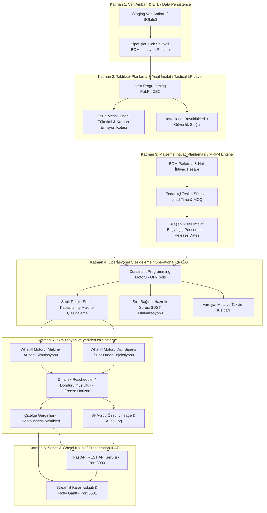

# FDI teknik başvuru / Technical reference

Ayrıntılı mimari, matematiksel model, API ve yerel kurulum notları. Kısa ürün özeti için [proje README dosyasına](../README.md) bakın.

## 🏗️ Sistem Mimarisi ve Karar Akışı / System Architecture

Sistem, endüstriyel karar piramidini hiyerarşik katmanlar halinde modeller:



---

## 📐 Matematiksel Modelleme / Mathematical Formulations

### 1. Taktiksel Katman: Çok Dönemli Agrega ve Yeşil Planlama (LP)
Model; müşteri taleplerini karşılarken üretim maliyeti, stok tutma maliyeti, fazla mesai maliyeti, gecikme (backlog) cezaları ile birlikte **enerji tüketim giderleri** ve **karbon salımı vergisi/kotalarını** bütüncül olarak minimize eder.

#### İndeksler ve Kümeler (Sets & Indices)
* $p \in P$: Nihai ürün aileleri ($p = 1, \dots, \vert{}P\vert{}$)
* $t \in T$: Planlama dönemleri (Haftalar: $t = 1, \dots, N$)
* $m \in M$: Makine / İstasyon grupları ($m = 1, \dots, \vert{}M\vert{}$)

#### Parametreler (Parameters)
* $D_{p,t}$: $t$ döneminde $p$ ürünü için müşteri talebi (adet)
* $CAP_{m,t}^{reg}$: $m$ istasyonunun $t$ dönemindeki normal çalışma kapasitesi (saat)
* $CAP_{m,t}^{ot\_max}$: $m$ istasyonunun azami fazla mesai limiti (saat)
* $a_{p,m}$: Ürün $p$'nin $m$ istasyonunda birim işlenme süresi (saat/adet)
* $c^p_{prod}$: Birim üretim maliyeti ($/adet)
* $h_p$: Dönem sonu birim stok tutma maliyeti ($/adet/dönem)
* $\pi_p$: Birim gecikmiş talep (backlog) cezası ($/adet)
* $c^m_{ot}$: İstasyon bazlı saatlik fazla mesai ücreti ($/saat)
* $e_p$: Ürün $p$'nin birim üretiminde harcanan enerji (kWh/adet)
* $c_{energy}$: Birim elektrik enerjisi fiyatı ($/kWh)
* $co2_p$: Ürün $p$'nin üretimi kaynaklı karbon salımı ($kg\ CO_2/adet$)
* $c_{carbon}$: Model içi karbon fiyatı varsayımı ($/kg\ CO_2$); uygulanmış vergi veya gerçekleşmiş maliyet değildir
* $CO2_{cap,t}$: $t$ dönemi için modelde varsayılan karbon senaryosu üst sınırı ($kg$); mevzuat limiti değildir

#### Karar Değişkenleri (Decision Variables)
* $X_{p,t} \ge 0$: $t$ döneminde üretilecek $p$ ürün hacmi
* $I_{p,t} \ge 0$: $t$ dönemi sonundaki $p$ ürün envanter düzeyi
* $S_{p,t} \ge 0$: $t$ döneminde karşılanamayan gecikmiş talep miktarı (backlog)
* $O_{m,t} \ge 0$: $t$ döneminde $m$ makinesinde uygulanan fazla mesai saati

#### Amaç Fonksiyonu (Objective Function)
$$\min Z = \sum_{t \in T} \Bigg[ \sum_{p \in P} \Big( c^p_{prod} X_{p,t} + h_p I_{p,t} + \pi_p S_{p,t} + \big(e_p \cdot c_{energy} + co2_p \cdot c_{carbon}\big) X_{p,t} \Big) + \sum_{m \in M} c^m_{ot} O_{m,t} \Bigg]$$

#### Kısıtlar (Constraints)
1. **Malzeme Dengesi ve Akış Kısıtı (Inventory Flow Balance):**
   $$I_{p,t-1} + X_{p,t} + S_{p,t} - S_{p,t-1} - I_{p,t} = D_{p,t} \quad \forall p \in P, \forall t \in T$$
2. **Kapasite ve Fazla Mesai Sınırı (Capacity & Overtime Upper Bound):**
   $$\sum_{p \in P} a_{p,m} X_{p,t} \le CAP_{m,t}^{reg} + O_{m,t} \quad \forall m \in M, \forall t \in T$$
   $$O_{m,t} \le CAP_{m,t}^{ot\_max} \quad \forall m \in M, \forall t \in T$$
3. **Yeşil İmalat: Dönemsel Karbon Kotası (Carbon Emission Ceiling):**
   $$\sum_{p \in P} co2_p X_{p,t} \le CO2_{cap,t} \quad \forall t \in T$$
4. **Başlangıç Durumları (Boundary Conditions):**
   $$I_{p,0} = Stok_{p}^{baslangic}, \quad S_{p,0} = 0 \quad \forall p \in P$$

---

### 2. Operasyonel Katman: Kısıt Programlama ile Çizelgeleme (CP-SAT)
Google OR-Tools CP-SAT motoru ile sonlu kapasiteli, sıra bağımlı hazırlık süreli (SDST) operasyonel çizelge oluşturulur.

#### Değişkenler ve Aralıklar (Interval Variables)
Her bir üretim görevi $i \in J$ için çözücü üzerinde aralık değişkeni tanımlanır:
$$Interval_i = [S_i, E_i, D_i] \implies E_i = S_i + D_i$$
* $S_i \in [0, T_{max}]$: Operasyon başlangıç dakikası
* $E_i \in [0, T_{max}]$: Operasyon bitiş dakikası
* $D_i$: İşlem süresi (Processing Duration)

#### Kısıtlar ve Mantıksal Kurallar
1. **Kaynak Çakışmama Kısıtı (Disjunctive Resource / No-Overlap):**
   Aynı tezgaha atanan herhangi iki operasyon $i$ ve $j$ zaman ekseninde örtüşemez:
   $$\text{NoOverlap}\big(\{Interval_i \mid Makine(i) = m\}\big) \implies (E_i \le S_j) \lor (E_j \le S_i)$$
2. **Sıra Bağımlı Hazırlık Süreleri (Sequence-Dependent Setup Times - SDST):**
   $i$ ürün grubundan $j$ ürün grubuna geçişte tezgahta temizlik, kalıp değişimi veya ayar süresi ($\tau_{type(i), type(j)}$) zorunludur:
   $$S_j \ge E_i + \tau_{type(i), type(j)} \quad (\text{eğer } j \text{ operasyonu } i\text{'nin hemen ardılı ise})$$
3. **Teknolojik Öncelik İlişkileri (Routing Precedence Constraints):**
   Aynı işin operasyonları proses sırasına uymak zorundadır:
   $$S_{job, op+1} \ge E_{job, op}$$
4. **Malzeme ve Tedarikçi Hazır Olma Kısıtı (Material Release Date):**
   MRP patlatmasından gelen hammadde ve bileşenler depoya girmeden imalat başlatılamaz:
   $$S_i \ge ReleaseTime_i$$
5. **Amaç Fonksiyonu:**
   Tamamlanma süresini (Makespan - $C_{max}$) ve termin gecikmelerini minimize etme:
   $$\min \left( \alpha \cdot C_{max} + \beta \sum_{i \in J} \max(0, E_i - DueDate_i) \right)$$

---

## 📦 Malzeme Gereksinim Planlaması (MRP-I)

Taktiksel LP planının ürettiği haftalık lot büyüklükleri, operasyonel seviyeye malzeme kısıtları olarak aktarılır:
* **Çok Seviyeli BOM Patlatma (Explosion):** Üst montajdan hammaddeye kadar hiyerarşik çarpan hesabı.
* **Tedarikçi Teslim Süresi Dengesi (Lead-Time Offsetting):** Parça temin süresi ($LT_k$) ve Minimum Sipariş Miktarı ($MOQ_k$) gözetilerek satın alma sipariş tarihleri geriye doğru çizelgelenir.
* **Malzeme Kısıtlı Çizelgeleme (Material-Constrained Scheduling):** Her operasyon için $ReleaseTime_i$ değeri malzeme varış saatine kilitlenerek sahada parça bekleme israfı önlenir.

---

## ⚡ Dinamik Müdahale, Karar Politikaları ve Gerginlik (Nervousness)

Atölye zemininde belirsizlikler gerçekleştiğinde uygulanan dinamik politikalar:

### 1. Dondurulmuş Ufuk Politikası (Freeze Horizon Policy)
Mevcut zamandan ($t_{now}$) itibaren belirlenen dondurma periyodu ($H_{freeze}$) içindeki operasyonlar sahada hazırlığı tamamlanmış veya işlem görmekte kabul edilir:
$$S_i = S_i^{orijinal}, \quad Makine_i = Makine_i^{orijinal} \quad \forall i \text{ where } S_i < t_{now} + H_{freeze} \text{ or } S_i \le t_{now}$$
Bu operasyonların sırası ve makine atamaları yeniden çizelgelemede **değiştirilemez**.
MES'te başlamış veya tamamlanmış operasyonlar, planlanan başlangıçları ileride olsa bile dondurulur. Dondurulmuş ufuktan sonraki `flexible_horizon_min` içindeki görevler FLEXIBLE durumundadır; aynı makinede kalır ve başlangıçları önceki değerden en fazla `max_flexible_shift_min` kadar hareket edebilir. Bu sınırları aşan sonuç kabul edilmez. Yayın öncesi bağımsız [aday denetimi](../docs/reschedule-core-candidate-audit-2026-10-17.md) temel zaman, setup aralığı, makine çakışması ve rota öncüllüğünü de kontrol eder; kapsam sınırları bağlantıdaki notta belirtilir.

Duruş, etkilenen tezgâhtaki dondurulmuş görevlerden sonra uygulanır; başlamış operasyonu kesip devam ettirme modellenmez. Ayrıntılar: [Run isolation and rescheduling](../docs/run-isolation-and-rescheduling.md).

`OPERATIONAL_BALANCED` süreleri dengeler. `COST_OPTIMIZED` parasal olarak ifade edilen TMC hedefidir: işçilik, setup, OT primleri, WIP holding, ağırlıklı gecikme, enerji, karbon, malzeme ve W1 expedite maliyetlerini `EconomicConfig` oranlarıyla minimize eder. Bu oranlar fabrika finansınca doğrulanmış tutarlar değildir. Sonuç ve bound para birimindedir; mikro para birimi yuvarlaması kaydedilir. FEASIBLE sonuç optimum veya diğer politikadan daha düşük maliyet garantisi değildir.

Orkestratör önce mevcut makine sırasını koruyan yerel onarım adayı üretir ve ortak üretim CP-SAT modeliyle bütün zamanları doğrular. Kabul edilirse `VALIDATED_LOCAL_REPAIR`, reddedilirse gerekçesiyle `CPSAT_REOPTIMIZATION` audit’e kaydedilir. Yerel doğrulama küresel optimum olarak işaretlenmez. Gerçek freeze/FLEXIBLE/duruş kısıtları yeni sürümde yeniden oynatılabilir biçimde saklanır.

### 2. Çizelge Gerginliği Metrikleri (Schedule Nervousness Metrics)
Yeniden optimizasyonun sahada yaratacağı operasyonel kaosu sınırlamak için iki metrik ölçülür:
* **Başlangıç Zamanı Sapması (Start Time Displacement):**
  $$\Delta S = \frac{1}{\vert{}J'\vert{}} \sum_{i \in J'} \vert{}S_i^{yeni} - S_i^{eski}\vert{}$$
* **Sıra Değişimi Adedi (Sequence Inversion Count):**
  Tezgahlardaki iş sıralamasının yer değiştirme sayısı.

---

## 📋 Standart Operasyon Prosedürleri (SOPs)

### SOP-01: Rutin Haftalık Planlama Çevrimi (Weekly Planning Routine)
1. **Veri Çekme:** Staging veritabanından güncel talep tahminleri ve envanter seviyeleri yüklenir.
2. **LP Çalıştırma:** PuLP modeli koşturularak haftalık agrega üretim hacimleri, fazla mesailer ve karbon bütçesi hesaplanır.
3. **MRP Patlatma:** Reçeteler (BOM) taranarak malzeme teslim tarihleri ve serbest bırakma saatleri ($ReleaseTime_i$) oluşturulur.
4. **CP-SAT Çizelgeleme:** OR-Tools motoru haftalık sonlu kapasiteli çizelgeyi üretir.
5. **Yayınlama:** Çizelge SQLite'a işlenir ve FastAPI/Streamlit üzerinden dağıtılır.

### SOP-02: Makine Arızası Müdahale Prosedürü (Breakdown Response)
1. **Varsayımsal analiz:** Makine, duruş başlangıcı ve süresiyle `/api/v1/schedule/what-if/breakdown` çağrılır. Bu çağrı zamanı sıfırdan başlayan ayrı bir plan üretir; yürütülmüş işi veya dondurulmuş ufku temsil etmez.
2. **Gerçek olay:** Saha olayı doğrulanırsa `/api/v1/schedule/reschedule` için olay zamanı ve dondurma ufku ayrıca verilir. Adayın fiziksel ve freeze kuralları bağımsız denetlenir. Laboratuvar API'si kabul edilen adayı doğrudan `ACTIVE` yayımlar; doğrulanmış planlamacı onayı ve saha actuals akışı henüz yoktur.

### SOP-03: Acil Sipariş Enjeksiyon Prosedürü (Hot-Order Injection)
1. **Öncelik Tanımlama:** Acil sipariş yüksek öncelik bayrağı ve teslim tarihi ile sisteme verilir.
2. **Plan etkisi:** `/api/v1/schedule/what-if/hot-order` ayrı bir aday çizelge ve planlanan KPI farklarını döndürür; mevcut müşteri teslimatının fiili sonucu veya otomatik kapasite tahsisi değildir.
3. **Operasyonel karar:** Mesai, öncelik ve yayımlama kararı saha kuralları ile yetkili planlamacıya aittir.

What-if fark raporunda makespan, hazırlık süresi ve lot başına öncelik ağırlıklı gecikme, çözücü özetinden bağımsız olarak baz ve aday çizelge satırlarından hesaplanır. Bunlar planlanan senaryo değerleridir; gerçekleşmiş teslimat veya tasarruf ölçüsü değildir.

---

## 🛡️ Kriptografik İzlenebilirlik (Lineage & Audit Trail)

Yayınlanan yeniden çizelgeleme kararları audit tablosuna ve karar kütüğüne kaydedilir; bundle dosyalarının SHA-256 özetleri değişiklikleri tespit eder. Sandbox what-if işlemleri runtime verisini değiştirmez:
* **Olay Kaydı:** Tetikleyici olay tipi (`BREAKDOWN`, `HOT_ORDER`, `PERIODIC`).
* **Veri Özeti (Cryptographic Hash):** Girdi ve çıktı çizelgeleri **SHA-256** özeti alınarak değişiklik denetimine bağlanır. Bu özet dijital imza veya yazma yetkisi ele geçirilmiş bir ortama karşı sahicilik kanıtı değildir.
* **Denetim Tablosu:** SQLite `reschedule_audit_log` tablosunda saklanır ve `/api/v1/schedule/audit-log` üzerinden denetlenebilir.

---

## 🧰 Teknoloji Yığını / Technology Stack

| Alan / Layer | Teknoloji / Kütüphane | Versiyon / Standart | Açıklama |
|---|---|---|---|
| **Matematiksel Modelleme** | Google OR-Tools (CP-SAT), PuLP | Python Library | Ayrık kısıt programlama ve lineer programlama çözücüleri |
| **Backend & REST Servis** | FastAPI, Uvicorn | 0.110+ | Asenkron, OpenAPI/Swagger destekli servis mimarisi |
| **Veri Şeması & Doğrulama** | Pydantic | v2.x | Tip güvenliği ve veri sözleşmeleri (Contracts) |
| **Karar Kokpiti & UI** | Streamlit, Plotly Express | 1.32+ | İnteraktif Gantt şeması, senaryo kıyası ve yönetici kokpiti |
| **Veri Tabanı & Analitik** | SQLite3, Pandas, NumPy | Python Builtin / 2.x | Veri ambarı, staging hatları ve denetim logları |
| **Test & Kalite Güvencesi**| Pytest, Ruff, GitHub Actions | CI quality gates | Birim, regresyon, entegrasyon ve Docker başlangıç testleri |
| **Konteynerizasyon** | Docker, Docker Compose | Python 3.11-slim | Pipeline hazırlığı, ACTIVE doğrulaması ve servis başlangıcı |

---

## 🔌 API Servis Katmanı ve Uç Noktalar

FastAPI backend servisi `http://localhost:8000` portunda yayın yapar. İnteraktif Swagger arayüzüne `http://localhost:8000/docs` adresinden erişilebilir:

`/health` ve `/ready` dışındaki uçlar [yerel erişim anahtarı](../docs/security-boundary.md#yerel-kullanım) gerektirir. Swagger'daki **Authorize** alanına ilgili Bearer anahtarını girin.

API, panel ve yerel MES dispatcher aynı runtime üzerinde aynı anda tek çözücü çalıştırır. Çakışan API çağrısı `429/SOLVER_BUSY` ve `Retry-After` döndürür; panel isteği meşgul uyarısı gösterir. Bu sınır tek hostlu laboratuvar kullanımına aittir.

| Metot | Uç Nokta (Endpoint) | Parametre / Gövde (Payload) | Açıklama |
|---|---|---|---|
| `GET` | `/health` | - | Servis canlılığı |
| `GET` | `/ready` | - | ACTIVE sürüm ve solver metadata kontrolü; run_id döndürür |
| `GET` | `/api/v1/operations/status` | `?max_active_age_min=1440` | Yetkili okuma anahtarıyla ACTIVE yayın yaşı, saat durumu ve bekleyen yerel MES niyetleri |
| `GET` | `/api/v1/schedule/current` | - | SQLite üzerindeki aktif operasyonel çizelgeyi döndürür |
| `POST` | `/api/v1/schedule/what-if/breakdown` | `{"machine_id": "M01", "start_min": 480, "duration_min": 60}` | Makine duruşunu simüle eder; gecikme ve sapma analizi sunar |
| `POST` | `/api/v1/schedule/what-if/hot-order` | `{"order_id": "HOT_01", "product_id": "P01", "quantity": 25, "due_date_min": 2880, "priority_weight": 10}` | Acil siparişin mevcut çizelge üzerindeki etkisini hesaplar |
| `POST` | `/api/v1/schedule/reschedule` | `{"trigger": {"event_id": "EVT-01", "current_time_min": 480, "freeze_horizon_min": 60, "delay_machine_id": "M01", "delay_duration_min": 60}}` | Dondurulmuş ufuk kurallarıyla yeni çizelgeyi üretir ve kaydeder |
| `GET` | `/api/v1/schedule/audit-log` | `?limit=50` | ACTIVE sürüme bağlı kalıcı yeniden çizelgeleme denetim kayıtlarını listeler |
| `GET` | `/api/v1/decisions` | - | ACTIVE sürümün SQLite'a kaydedilmiş karar gerekçelerini salt okunur olarak döndürür |

Karar geçmişi SQLite'ta kalıcıdır; yeniden çizelgeleme kararları sürüm kimliğiyle sorgulanır. Bu, tek sunuculu POC denetim kaydıdır; harici bir enterprise audit platformu iddiası taşımaz.

ISA-95 adaptörleri kanonik sözleşmeler ile MESA B2MML 0701 resmî XSD’lerine karşı doğrulanan çizelge/MES XML export ve import sağlar. Desteklenen fabrika profili, timezone-aware Pazartesi başlangıç zamanı ve kaynak şema hash’leri açıkça tanımlıdır. Belirli vendor endpoint’iyle gerçek birlikte çalışabilirlik müşteri kabul testi gerektirir; yapılmış olarak gösterilmez.

Dashboard benchmark’ı kullanıcı düğmesiyle başlatılır. FIFO/EDD/SPT/Greedy makine sırasını seçer; her çizelge aynı üretim CP-SAT modeli, veri snapshot’ı, takvim, bakım, rota, setup, malzeme, OT ve freeze/FLEXIBLE kısıtları altında yerleştirilir. Çizelge üzerindeki lot gecikmeleri, model maliyetleri, süreler ve ölçülen EDD farkı raporlanır. Saf sezgisel runtime karşılaştırması veya müşteri ROI kanıtı değildir. [Ölçülmüş demo](../artifacts/demo/business-case.md) ve [demo/müşteri pilot rehberi](../docs/demo-and-customer-pilot.md) yeniden üretme adımlarını içerir.

---

## 📊 Karar Destek Kokpiti (Streamlit)

Streamlit karar paneli (`http://localhost:8501`), karar vericilere interaktif yetenekler sunar:
* **Gantt Çizelgesi Görselleştirme:** Makine, ürün grubu ve SDST hazırlık sürelerinin zaman çizelgesindeki renkli dağılımı.
* **Darboğaz & Kapasite Paneli:** İstasyon doluluk oranları, bekleme süreleri ve fazla mesai analizleri.
* **What-If Simülatörü:** Web arayüzünden arıza veya acil sipariş tetikleyerek çizelgeleri yan yana karşılaştırma.
* **Lineage & Audit Gezgini:** Sistem kararlarının ve kriptografik özetlerin denetim dökümü.

---

## 🚀 Kurulum, Test ve Çalıştırma Rehberi

### 1. Yerel Python Ortamı Kurulumu

```text
git clone https://github.com/AliUmutKazak/factory-decision-intelligence.git
cd factory-decision-intelligence
```

Python 3.11 ile, kullandığınız kabuğa uygun komutları çalıştırın.

Windows PowerShell:

```powershell
python --version # 3.11.x olmalı
python -m venv factory-env
.\factory-env\Scripts\python.exe -m pip install -r requirements-windows.lock
```

Linux x86_64:

```bash
python3.11 -m venv factory-env
source factory-env/bin/activate
python -m pip install -r requirements-linux.lock # Linux x86_64
```

macOS veya farklı mimaride `requirements.txt` üzerinden kurulum yapılır; bu platformlarda transitive lock doğrulaması bu sürümün CI kapsamına dahil değildir.

Sonraki `python` komutlarında Windows'ta `.\factory-env\Scripts\python.exe` kullanın veya ortamı `.\factory-env\Scripts\Activate.ps1` ile etkinleştirin. PowerShell yürütme ilkesi etkinleştirmeyi engelliyorsa doğrudan `python.exe` yolu yeterlidir.

### 2. Pipeline, doğrulama ve testler

Servislerden ve entegrasyon testlerinden önce doğrulanmış bir ACTIVE plan oluşturun:

```bash
python main.py
python scripts/verify_active_run.py
python -m pytest tests/ -v
```

### 3. FastAPI Servisini Başlatma

```bash
uvicorn src.api.server:app --reload --port 8000
```
* **Swagger Arayüzü:** `http://localhost:8000/docs`
* **Health Check:** `http://localhost:8000/health`

### 4. Karar Destek Kokpitini Başlatma (Streamlit)

Ayrı bir terminalde:
```bash
streamlit run dashboard/app.py
```
* **Kullanıcı Paneli:** `http://localhost:8501`

---

## 🐳 Docker ile Dağıtım

Docker Compose ilk başlangıçta pipeline çalıştırır, bundle ve ACTIVE run doğrulamasından sonra API ve dashboard servislerini açar. Sonraki başlangıçlarda doğrulanmış mevcut ACTIVE sürümü kullanır:

Linux/macOS:

```bash
export FACTORY_BUILD_GIT_SHA="$(git rev-parse HEAD)"
docker compose up --build -d --wait --wait-timeout 240 api dashboard
```

Windows PowerShell:

```powershell
$env:FACTORY_BUILD_GIT_SHA = git rev-parse HEAD
$env:FDI_API_READ_TOKEN = python -c "import secrets; print(secrets.token_urlsafe(48))"
$env:FDI_API_SCENARIO_TOKEN = python -c "import secrets; print(secrets.token_urlsafe(48))"
$env:FDI_API_RESCHEDULE_TOKEN = python -c "import secrets; print(secrets.token_urlsafe(48))"
docker compose up --build -d --wait --wait-timeout 240 api dashboard
```

* **FastAPI Backend:** `http://localhost:8000/docs`
* **Streamlit Dashboard:** `http://localhost:8501`
* **Hazır olma kontrolü:** `http://localhost:8000/ready`
* **Durdurmak için:** `docker compose down`

Panelin kenar çubuğuna bu oturum için uygun anahtarı girin. Anahtarlar yalnız bu PowerShell oturumunun ortamında kalır; aynı oturumdan başlatılan Compose servislerine aktarılır.

`data/`, `reports/` ve `artifacts/runs/` kalıcı ve servisler arasında paylaşılan dizinlerdir. Mevcut ACTIVE bundle doğrulanamazsa başlangıç durur. Bilinçli yeni plan üretimi için `docker compose run --rm pipeline python scripts/bootstrap_runtime.py --refresh` çalıştırın. Temiz Docker başlangıcı ve yeniden başlatma CI içinde sınanır. Bu dağıtım tek sunuculu demo/POC içindir; üretim SaaS hazır olduğu iddia edilmez.

---

## 📂 Dizin Yapısı / Directory Tree

```text
factory-decision-intelligence/
├── data/                       # Üretim veritabanı (factory.db) ve staging tabloları
├── dashboard/                  # Streamlit karar destek arayüzü
│   └── app.py                  # Karar kokpiti, Gantt grafikleri ve senaryo paneli
├── src/
│   ├── api/                    # FastAPI REST servis mimarisi
│   │   └── server.py           # Endpoint tanımları ve HTTP işleyicileri
│   ├── contracts/              # Pydantic veri sözleşmeleri ve şemaları
│   ├── planning/               # Kademe 1: Taktiksel LP Planlama (PuLP / CBC)
│   ├── mrp/                    # Kademe 2: MRP-I, BOM patlatma ve lead-time dengeleme
│   ├── scheduling/             # Kademe 3 & 5: CP-SAT Çizelgeleme ve What-If motoru
│   │   ├── schedule_cpsat.py   # OR-Tools sonlu kapasite çizelgeleyicisi
│   │   ├── what_if.py          # Arıza ve acil sipariş simülatörü
│   │   └── rescheduler.py      # Freeze Horizon & Dinamik Rescheduler
│   └── config.py               # Konfigürasyon, yollar ve ortam değişkenleri
├── tests/                      # Birim, entegrasyon ve regresyon testleri
├── Dockerfile                  # Python 3.11-slim Docker imaj reçetesi
├── docker-compose.yml          # FastAPI ve Streamlit mikroservis orkestrasyonu
├── .dockerignore               # Docker imaj filtreleme kuralları
├── requirements.txt            # Doğrudan Python bağımlılıkları
├── requirements-linux.lock     # Linux x86_64 / Python 3.11 tam çözüm
├── requirements-windows.lock   # Windows x86_64 / Python 3.11 tam çözüm
└── README.md                   # Kapsamlı sistem ve mimari dokümantasyonu
```

---

## 📜 Lisans & Geliştirici / License & Author

* **Geliştirici / Author:** Ali Umut Kazak — Endüstri Mühendisi / Karar Zekası & Optimizasyon
* **Lisans / License:** Projenin özgün kodu ve belgeleri [MIT](../LICENSE) lisanslıdır. `src/contracts/xsd/b2mml-0701/` altındaki MESA şemaları [kendi lisansı](../src/contracts/xsd/b2mml-0701/LICENSE) kapsamındadır. The Business To Manufacturing Markup Language (B2MML) is used courtesy of MESA International.
